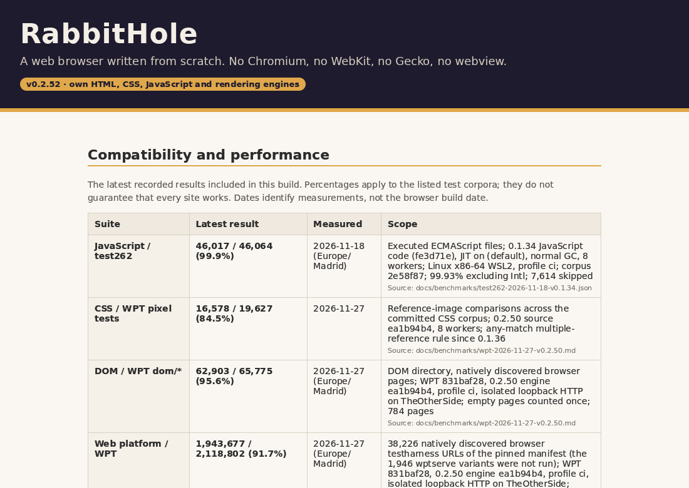
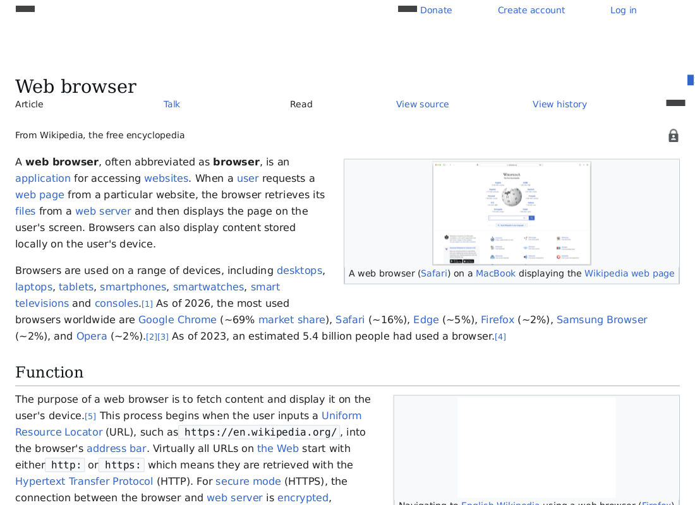

# RabbitHole Browser

**A web browser written from scratch in Rust.** No Chromium, no WebKit, no Gecko,
no system webview. RabbitHole ships its own HTML parser, CSS parser and cascade,
layout engine, font rasterization and a software rasterizer, and paints the
result straight into a native window on Linux, macOS and Windows.

It can be used three ways:

- as a **desktop browser** (a native window, drawn entirely by our own code),
- as a **command line tool** (headless screenshots, text extraction, link listing, tree dumps),
- as an **MCP server** so LLM agents such as Claude can read and screenshot the web through it.





_Both images were produced by RabbitHole's renderer: every pixel comes from its own rasterizer._

## Status (v0.2.48)

RabbitHole is young but already runs real, heavy sites: Google search,
YouTube (playback with sound and AV1/VP9 video), Wikipedia,
Reddit (infinite scroll), BBC, Hacker News, the Svelte playground (WebAssembly
bundler in a Worker) and Speedometer 3.1 end to end. Everything below is our own
code unless noted in [Dependencies](#dependencies).

The JavaScript JIT is **on by default** on x86-64 (Windows and Linux) since
0.1.21; `--jit=off` or `RABBITHOLE_JIT=off` selects the interpreter. In a
paired Speedometer 3.1 run on 17 November 2026 it was faster in 10 of 10 blocks,
median 1.020× ([record](docs/benchmarks/speedometer-2026-11-17-jit-default.md)).
macOS on Apple silicon has no native backend yet and uses the interpreter. See
the [JIT design and status](docs/jit-design.md).

Version 0.2.48 is **1.032× faster than 0.2.47 on Speedometer 3.1** (7 of 8
paired runs; jQuery 1.13×, React-Redux 1.12×, SVG charts 1.11×,
[record](docs/benchmarks/speedometer-2026-11-26-v0.2.48.md)). Compiled
JavaScript functions now call each other and return in native code, common
builtins such as `hasOwnProperty`, `Array.isArray` and `Math.round` are
computed inline, and the shared property cache also serves stores, missing
properties, `typeof`, for-in and object creation. The JIT may keep up to
48 MiB of code per thread (previously 16 MiB). Web platform and CSS results
are unchanged.

Version 0.2.47 is **1.162× faster than 0.2.46 on Speedometer 3.1** (8 of 8
paired runs; chart and SVG suites 1.3–1.5×,
[record](docs/benchmarks/speedometer-2026-11-25-v0.2.47.md)). Child frames,
inline SVG and canvas 2D are rasterized when the page is presented, not inside
script work, and canvas 2D records its drawing until pixels are needed. Network
work leaves the main thread: `navigator.sendBeacon` sends in the background
with its body, module graphs download in parallel, and the Cache API stores
bodies as bytes indexed by URL. Text shaping reuses faces and plans, compiled
page scripts are shared between frames, and ordered lists renumber only after
a changed item. Loading a large repository page drops from 2.3 s to 0.96 s and
a long encyclopedia article from 1.6 s to 0.99 s. Web platform and CSS results
are unchanged from 0.2.46.

Version 0.2.46 completes several areas of the web platform. WPT testharness
rises to **89.8 %** (1,578,581 / 1,757,120 subtests on 38,226 pages;
[record](docs/benchmarks/wpt-apis-2026-11-25-v0.2.46.md)): HTML DOM 99.0 %,
CSS Color 99.1 %, CSS Grid 95.7 %, WebCrypto 99.9 % and editing 96.5 %. It adds
multi-column layout (`column-count`, `column-width`, spanners, balancing and
fragmentation), baseline alignment and subgrid in grid layout, CSS Color 4/5 at
full precision (`color-mix()`, relative colors, `light-dark()`), IANA time
zones on every platform (an embedded tz database when the system has none),
post-quantum and modern WebCrypto algorithms (ML-KEM, ML-DSA, Ed448, X448,
AES-OCB, SHA-3, Argon2), the editing algorithms of the WPT reference
implementation, and fixes for CSS transitions that never started after a style
sheet change. WPT CSS reftests reach 84.5 %
([record](docs/benchmarks/wpt-css-2026-11-25-v0.2.46.md)). Speedometer 3.1 is
1.027× faster than 0.2.45 in 8 of 8 paired runs; chart drawing with canvas 2D
is 1.45× faster ([record](docs/benchmarks/speedometer-2026-11-25-v0.2.46.md)).

Version 0.2.45 opens the 0.2 series with a broad pass over the web platform
APIs, measured with WPT testharness: **87.4 %** of 1,756,838 subtests on 38,226
browser pages, against 44.0 % for 0.1.44 on the same pages
([record](docs/benchmarks/wpt-apis-2026-11-24-v0.2.45.md)). It adds rich text
editing (`execCommand`, `beforeinput` target ranges and keyboard editing in
`contenteditable`), WebCrypto with native primitives (SHA, HKDF/PBKDF2, AES-GCM,
ChaCha20-Poly1305, ECDH/ECDSA on NIST curves, X25519, Ed25519 and RSA), WebRTC
data channels over UDP with ICE, DTLS and SCTP, CSS anchor positioning with
`position-try` fallbacks, motion paths, wide-gamut computed colors, popovers,
declarative shadow DOM options, Blob/File/FormData/XMLHttpRequest conformance,
structured cloning across frames and workers, and restricted network ports.
WPT CSS reftests rise to 83.7 % with no test lost
([record](docs/benchmarks/wpt-css-2026-11-23-v0.2.45.md)). Speedometer 3.1 is
about 0.7 % slower than 0.1.44 in 22 paired runs; no single cause was found
([record](docs/benchmarks/speedometer-2026-11-23-v0.2.45.md)). The cryptography
and WebRTC dependencies add about 7 MB to the executable (Linux 37.1 → 44.6 MB,
Windows 37.4 → 43.8 MB). From this version the
last version number counts deliveries without resetting (0.1.44 → 0.2.45).

Version 0.1.44 fixes app startup on popular sites: built-in Web APIs
(`MessageChannel`, `requestIdleCallback`, `scheduler.postTask`, observers) keep the
engine's own timers when pages replace `setTimeout`; stylesheet `<link>` load
events fire after a script forces layout; frames inside shadow trees keep their
document; `:scope` matches the element a DOM query runs on; parser-inserted
external scripts fire `load`/`error`. Speedometer 3.1 is about 0.7 % slower than
0.1.43 ([record](docs/benchmarks/speedometer-2026-11-21-v0.1.44.md)).

Version 0.1.43 keeps single-page apps in their document: `location.href`,
`assign`, `replace`, `location =`, script link clicks and `window.open(…, '_self')`
that change only the fragment no longer reload the page (webmail reloaded after
opening each message), `pushState`/`replaceState` update the address bar and
back/forward history, and back/forward between entries of one document fire
`popstate`/`hashchange` instead of reloading. Content decoding accepts every
`Content-Encoding` line and the lenient brotli/gzip/zstd cases browsers accept;
undecodable video-only files fall back to the next `<source>`; built-in Web API
functions print as native code; `atob` follows the forgiving-base64 rules; module
import maps are parsed once ([measurement](docs/benchmarks/wpt-css-2026-11-21-v0.1.43.md),
[Speedometer](docs/benchmarks/speedometer-2026-11-21-v0.1.43.md)).

Version 0.1.42 fixes problems found on popular websites: `parentElement` no
longer returns a shadow root, `iframe.sandbox` and `link.sizes` are token lists,
`navigator` members live on `Navigator.prototype`, network-information and
media-device objects are event targets, CSS `env()` and
`getComputedStyle().getPropertyValue('--x')` work, anchor URL parts can be
set, `background-clip: text` applies to inline elements, a no-cors fetch drops
unsafe headers instead of failing, and `WEBGL_debug_renderer_info` exists.
The baseline JIT handles more property caches natively; Speedometer 3.1 is
1.033× faster than 0.1.41 ([record](docs/benchmarks/speedometer-2026-11-21-v0.1.42.md)).

Version 0.1.41 is 1.069× faster than 0.1.40 on Speedometer 3.1 (8 of 8 paired
runs, every suite faster; NewsSite 1.16–1.23×, [record](docs/benchmarks/speedometer-2026-11-21-v0.1.41.md)):
function `prototype` objects are created on first use, call scopes take one
allocation, and frames copy precompiled built-in scripts instead of compiling
them again. Glyph outlines are fitted to the pixel grid vertically, as FreeType
light hinting does (WPT CSS 83.5 %, [measurement](docs/benchmarks/wpt-css-2026-11-21-v0.1.41.md)).

Version 0.1.40 is 1.119× faster than 0.1.39 on Speedometer 3.1 (8 of 8
paired runs, every suite faster; [record](docs/benchmarks/speedometer-2026-11-21-v0.1.40.md)):
the JavaScript allocator and collector are cheaper (collector time over three
iterations 5.2 s → 1.8 s), custom-property maps are layered instead of copied,
and `querySelector` uses attribute and class indexes; pages with many DOM
nodes load up to 1.4–1.5× faster. `line-height: normal` follows the first
available font's metrics, with `ascent-override`, `descent-override` and
`line-gap-override` (WPT CSS 83.0 %, [measurement](docs/benchmarks/wpt-css-2026-11-21-v0.1.40.md)).

Version 0.1.39 fixes web compatibility: `DOMTokenList` (`classList`) answers
indexed reads (`classList[0]`), which webmail with inbox category tabs needs
to start; web fonts register every `unicode-range` subset of a face and
variable fonts are drawn at their declared weights; consecutive floats add
up in max-content widths; service workers and pages exchange messages
(`postMessage`, `clients.matchAll`, `MessageChannel`). Speedometer 3.1 is
unchanged against 0.1.38 ([record](docs/benchmarks/speedometer-2026-11-20-v0.1.39.md)).

Version 0.1.38 is 1.133× faster than 0.1.37 on Speedometer 3.1 (8 of 8 paired
runs; NewsSite 1.8–1.9×, TodoMVC ES6 Complex-DOM 1.48×,
[record](docs/benchmarks/speedometer-2026-11-20-v0.1.38.md)). Text selection is
real: mouse drag, double and triple click, Shift+click, Ctrl+A/Ctrl+C, the
Selection API, `::selection` and the CSS Custom Highlight API (WPT `/selection/`
98.3 % of subtests). SVG filter primitives work through `filter: url()`
(filter-effects 75.9 %). WPT CSS reftests: 82.7 % (16,228 / 19,627,
[measurement](docs/benchmarks/wpt-css-2026-11-20-v0.1.38.md)).

Version 0.1.37 raises the WPT CSS reftests to 82.1 % (16,122 / 19,627,
[measurement](docs/benchmarks/wpt-css-2026-11-19-v0.1.37.md)):
- vertical writing modes (writing-modes 45 % → 79.5 %);
- 3D transforms with `perspective`, `preserve-3d`, `backface-visibility` and
  the individual `translate`/`rotate`/`scale` properties (transforms 47 % → 92.6 %);
- container queries and container units, wide-gamut colour interpolation,
  `revert-layer`, typed `attr()`, CSS math functions, `:dir()`/`:lang()`.

Cookies follow RFC 6265bis more closely: quoted values are kept, SameSite is
persisted, windows merge rather than overwrite the cookie file, and documents
honour their referrer policy (single sign-on flows). Speedometer 3.1 is
unchanged against 0.1.36 (0.9993×, [record](docs/benchmarks/speedometer-2026-11-20-v0.1.37.md)).

Version 0.1.36 raises the WPT CSS reftests to 76.4 % (14,996 / 19,627,
[measurement](docs/benchmarks/wpt-css-2026-11-19-v0.1.36.md); from this run on,
a reftest with several match references passes when any of them matches, as
WPT specifies):
- UAX #14 line breaking, justification, hyphenation and skip-ink
  underlines (css-text 76.2 %);
- `::first-letter`, floats, tables and sticky positioning (CSS2 91.0 %);
- border-image, conic and tiled gradients, gradient colour spaces, SVG images
  at their drawn size, EXIF orientation, line-clamp and OpenType font
  features (backgrounds 81.6 %, images 86.1 %).

An iframe whose document changes only its URL fragment is no longer reloaded,
and images served from the cache fire `load`. Speedometer 3.1 is 1.0095×
faster than 0.1.35, in 8 of 8 paired runs
([record](docs/benchmarks/speedometer-2026-11-19-v0.1.36.md)).

Version 0.1.35 raises the WPT CSS reftests from 63.2 % to 67.9 % (13,328 /
19,627, [measurement](docs/benchmarks/wpt-css-2026-11-19.md)):
- `clip-path` basic shapes, SVG `url()` clip paths, `border-shape` and `corner-shape`
  (css-masking 25.0 % → 67.7 %);
- grid track sizing, alignment and subgrid fixes (grid 58.7 % → 76.9 %);
- flexbox and intrinsic sizing (flexbox 69.3 % → 84.3 %, sizing 50.7 % → 69.2 %);
- `font-stretch` matching.

CSS animations present at load now run, and the Web Animations API is
implemented (`element.animate()`, `getAnimations()`, `CSSAnimation`/`CSSTransition`
objects; WPT web-animations subtests 31.5 % → 49.1 %, partial measurement in the
same record). DOM fixes make the Cloudflare dashboard's sign-in render. Speedometer
3.1 is 1.016× faster than 0.1.34 in paired runs, but the NewsSite tests are 2 to
2.5 % slower ([record](docs/benchmarks/speedometer-2026-11-19-v0.1.35.md)).

Version 0.1.34 completes JavaScript up to ES2025: test262 passes 99.93 % of the
executed files outside Intl and 99.90 % overall (ECMA-402 98.6 %), `SharedArrayBuffer` memory is
shared between threads with real `Atomics`, module cycles with top-level `await`
follow the specification, and Intl gains `DurationFormat` and specification-level
`NumberFormat`, `PluralRules`, `DateTimeFormat`, `Locale`, `ListFormat`,
`RelativeTimeFormat`, `DisplayNames`, `Segmenter` and `Collator` ([measurement](docs/benchmarks/test262-2026-11-18-v0.1.34.md)).
Speedometer 3.1 and page loads are unchanged by these changes (paired runs:
1.002× and 1.001×).

Version 0.1.33 reuses an element's custom property map when neither its parent's
map nor its own declarations changed: pages with many custom properties load up
to 1.34× faster, other pages and Speedometer 3.1 are unchanged
([measurement](docs/benchmarks/page-load-2026-11-18-vars-reuse.md)).

Version 0.1.32 loads pages with large design-system stylesheets faster (18 %
over the benchmark pages) by sharing inherited CSS custom properties; Speedometer
3.1 is 0.8 % slower ([measurement](docs/benchmarks/page-load-2026-11-18-css-vars.md)).

Version 0.1.31 loads pages about 35 % faster: bundled fonts are parsed on
first use instead of at start-up, and font fallback checks a candidate's
character map before loading it ([measurement](docs/benchmarks/page-load-2026-11-18-fonts.md)).

Versions 0.1.23–0.1.30 made Speedometer 3.1 much faster, each step measured
on the complete suite with paired, rotated runs of identically built binaries
(the records give every pair, the per-suite results and the conditions):

| Version | Change | Speedometer 3.1 (median paired ratio) |
|---|---|---:|
| 0.1.30 | Frames repainted by damage instead of whole ([record](docs/benchmarks/speedometer-2026-11-18-frame-damage.md)) | 1.023× |
| 0.1.28 | Blurred box shadows cached instead of recomputed on every repaint ([record](docs/benchmarks/speedometer-2026-11-18-shadow-cache.md)) | 1.218× (TodoMVC 1.08–1.86×) |
| 0.1.27 | Frames and canvases at their own size copied directly when composited ([record](docs/benchmarks/speedometer-2026-11-18-image-copy.md)) | 1.020× |
| 0.1.26 | Layout fingerprints memoized per box ([record](docs/benchmarks/speedometer-2026-11-18-fingerprint-memo.md)) | 1.028× |
| 0.1.25 | Fast hashing of layout fingerprints ([record](docs/benchmarks/speedometer-2026-11-18-fingerprint-hash.md)) | 1.039× |
| 0.1.24 | Measured grid items reuse their published layout ([record](docs/benchmarks/speedometer-2026-11-18-grid-measure-cache.md)) | 1.068× |
| 0.1.23 | Flex items measured and stretched served by the layout cache ([record](docs/benchmarks/speedometer-2026-11-18-layout-cache.md)) | 1.056× (NewsSite 1.7×) |

Version 0.1.22 lowers the agent interface's token cost found by the
RH-AGENT-002 battery: `find` shows the card or table row around a short match
and its link, `snapshot` cuts page chrome before main-content lists, prints a
repeated URL once and table rows as single lines, and expand refs return only
the omitted items. Tool definitions and instructions are 11 % shorter.
Scripted scrolling (`scrollTo`, `scrollBy`, `scrollTop`) now fires `scroll`
events, so pages that load more content on scroll work when scrolled by script.

Version 0.1.20 adds mouse interaction with the page scrollbar and **Copy all**
in DevTools Elements, exporting the current main document as HTML. It also
preserves incremental paint damage when iframe images change at the same size,
queues script-requested scroll events to avoid recursive dispatch, and stops
resource `load` events at Document so they cannot multiply Window load callbacks.
Open desktop reports include a blank view after Gmail sign-in and GitHub pages
becoming unresponsive; these flows still need verification.

Version 0.1.19 fixes React-compatible assignments to replaceable Window
attributes, keeps fragment navigation within the same document in the MCP,
and adds real double-click interaction with `click double=true`. Hidden-control
errors also suggest hovering the container. The ten-step TodoMVC flow was
verified directly through MCP, including editing and persistence after reload;
this is a functional check, not a new model benchmark.

Version 0.1.18 included named Grid line placement, used Grid track values in
CSSOM, and bounded legacy frameset geometry. Directed visual checks passed
33/33 on that tested CSS revision; this is not a new full WPT coverage result.

### Conformance and benchmarks

| Suite | Result | Notes |
|---|---|---|
| **test262** (ECMAScript) | **99.90 %** (46,017 / 46,064 run) | 2026-11-18, 0.1.34 JavaScript code `fe3d71e`, JIT on, 8 workers, profile ci; **99.93 % excluding Intl**, ECMA-402 98.6 %; multi-agent `Atomics` and `Intl.NumberFormat` v3 tests included; [measurement](docs/benchmarks/test262-2026-11-18-v0.1.34.md) and `crates/js/tests/test262_baseline.txt` |
| **WPT testharness** (web APIs: DOM, HTML, Encoding, Fetch, WebCrypto, editing, CSSOM, …) | **89.8 %** (1,578,581 / 1,757,120 subtests, 38,226 pages) | 2026-11-25, 0.2.46 engine `7b235dfb`, WPT `831baf28`, natively discovered browser pages (1,946 wptserve variants not run); 0.2.45 had 87.4 % and 0.1.44 44.0 % on the same pages; [measurement](docs/benchmarks/wpt-apis-2026-11-25-v0.2.46.md) and `tools/wpt/` |
| **WPT CSS reftests** (pixel comparison) | **84.5 %** (16,576 / 19,627) | 2026-11-25, 0.2.46 source `7b235dfb`; color 96.5 %, box 95.2 %, transforms 94.3 %, CSS2 92.9 %, css-ui 91.2 %, images 90.7 %, flexbox 85.8 %, grid 84.2 %; any-match rule for multiple references; [measurement](docs/benchmarks/wpt-css-2026-11-25-v0.2.46.md) and `crates/engine/tests/wpt-css-baseline.txt` |
| **WebAssembly spec testsuite** | **99.99 %** (66,747 / 66,757) | every proposal at 100 % except two outdated threads/descriptor cases |
| html5lib tree construction | 1,935 / 1,945 | |
| WHATWG URL tests | 899 / 899 (+ 278 / 278 setters) | |
| Acid2 | **0 pixels** different from the reference | |
| Acid3 | 96 / 100 | |
| Framework suite (React 18/19, Vue 3, Svelte 5, Lit 3, Preact, Solid, Alpine, htmx, jQuery) | 66 / 66 in both modes | functional DOM/input checks on 2026-11-14 (Europe/Madrid), v0.1.11 source `b88c8ff`, WSL2/Linux x86-64; JIT off/on with threshold 0 and incremental-GC stress, profile ci; [measurement](docs/benchmarks/frameworks-2026-11-14-v0.1.11.json), not a timing benchmark |
| Speedometer 3.1 | **3.141** with the JIT (default); 3.103 without (mean scores) | 2026-11-18, v0.1.28 source `fb184d8`; 8 runs/mode, 20 workloads × 3 iterations, headless release/Rust 1.99.1, i7-12700H/WSL2 x86-64/CPU 0; on 0.1.18 the same setup gave 2.102 / 2.082. [Record and scope](docs/benchmarks/speedometer-2026-11-18-v0.1.28.md) |
| JavaScript microbenchmarks | 27 cases, 432 observations | 2026-11-15, same v0.1.18 source and release/CPU conditions; individual medians/ranges, no aggregate speedup. `array_map` is **0.990×**. [All cases](docs/benchmarks/performance-2026-11-15-v0.1.18.md#individual-javascript-microbenchmarks) |
| Directed CSS pixel controls | 33 / 33 | 2026-11-15, bootstrap source `37cb93d`, profile ci; CSS code identical to final 0.1.18. 31 WPT cases and 2 local controls; no fresh global CSS/WPT percentage. [Scope](docs/benchmarks/performance-2026-11-15-v0.1.18.md#directed-css-controls) |

The built-in start page shows the complete compiled version and the latest
dated results from the committed records. Baseline-derived counts refresh at
build time; performance results retain their measurement context.
See [measurement sources and updates](tools/metrics/README.md).

[MCP benchmark: RabbitHole vs Chrome + Playwright](docs/benchmarks/mcp-2026-11-15-v0.1.15.md)
reports agent-task results supplied by the project owner for v0.1.15 on
15 November 2026, with three runs per task and browser.

## Features

**Parsing & styling**

- Spec HTML tokenizer and tree builder (WHATWG parsing algorithm, fragments,
  templates, declarative shadow DOM), XML parser for XHTML/SVG documents,
  WHATWG URL parser with IDNA, the full Encoding Standard.
- CSS: selectors level 4 (`:is`/`:where`/`:has`/`:not`, `:host`/`::slotted`),
  cascade layers (`@layer`), `@media`/`@supports`/`@font-face`/
  `@keyframes`, custom properties, `calc()`/`min()`/`max()`/`clamp()` mixing
  percentages and lengths, modern colors (`oklch`, `lab`, `color-mix`,
  `light-dark`), containment, CSS transitions and animations.
- Incremental restyle and relayout (only dirty subtrees, including shadow
  trees), so pages that mutate the DOM constantly stay responsive.

**Layout & painting**

- Block, inline (with block-in-inline splitting), floats, CSS 2.1 tables,
  flexbox, grid, positioning (relative/absolute/fixed/
  sticky), stacking contexts, vertical writing modes, Unicode bidi.
- Own software rasterizer: anti-aliased paths and strokes, gradients, shadows,
  per-corner radii, 2D/3D-flattened transforms, filters and `backdrop-filter`,
  masks, opacity layers, the top layer for modal dialogs.
- Text shaping with OpenType features (ligatures, kerning, Arabic joining,
  right-to-left runs), color emoji (COLR/CPAL, CBDT, sbix), web fonts
  (TTF/OTF/WOFF/WOFF2), system font discovery.
- Form controls drawn with Chrome's look and `appearance` support; images in
  PNG, JPEG, GIF/APNG/WebP (animated) and AVIF, responsive images and lazy
  loading; own SVG renderer.

**JavaScript and WebAssembly**

- Own JavaScript engine (`crates/js`): lazy parser and compiler, register-based
  interpreter with hidden classes and inline caches, 8-byte NaN-boxed values,
  size-class allocator, mark-and-sweep GC, ES2025 language and standard library
  (including `SharedArrayBuffer`/`Atomics` across threads) and ECMA-402 `Intl`,
  ES modules, own regular expression engine, and a baseline x86-64 JIT with
  loop OSR (on by default on x86-64; `--jit=off` disables it).
- Own WebAssembly engine (`crates/wasm`): validator, interpreter and a
  baseline x86-64 compiler; the `WebAssembly` JS API in pages and workers.
- Web platform (`crates/script`): the full WebIDL surface of DOM, HTML, CSSOM,
  Shadow DOM and custom elements, events (pointer, keyboard, wheel), observers
  (Mutation/Intersection/Resize), canvas 2D, fetch/XHR with CORS, WebSocket,
  EventSource, Streams, IndexedDB, Web Crypto, Workers, iframes with
  same-origin scripting and `postMessage`, history and Navigation API.
- Experimental WebGL1 and WebGL2: own software shader evaluator, clipping and
  triangle rasterizer, vertex/index buffers, uniforms, depth testing, RGB/alpha
  blending, nearest/bilinear RGBA8 2D textures, canvas presentation and `readPixels`.
  WebGL2 adds a bounded GLSL ES 3.00 subset, vertex array objects and checked
  32-bit indices with fixed primitive restart. Shader math includes 32 typed
  float/vector built-ins; general shader control flow remains unfinished. See
  [supported operations and limits](docs/webgl.md); these are rendering subsets,
  not full WebGL conformance.
- Service Worker lifecycle: classic scripts run in an isolated worker realm,
  with installation/activation, `waitUntil`, updates, `skipWaiting` and
  `clients.claim`. Registrations and origin-scoped Cache API data live in memory
  within an engine instance. Controlled documents' `window.fetch()` requests
  dispatch `FetchEvent` and can receive real responses through `respondWith`,
  including Cache API matches and worker-initiated network fetches. Initially
  controlled top-level GET HTTP(S) navigation also works through `Engine::load`
  and the asynchronous GUI loader, including cached HTML after the server stops
  within that same engine. See [the supported scope](docs/service-workers.md).

**Media**

- Audio output on Windows (WASAPI), Linux (PulseAudio/PipeWire/ALSA loaded at
  run time) and macOS (CoreAudio); MP3, AAC, FLAC, Vorbis, Opus, WAV.
- `<audio>`/`<video>` and Media Source Extensions (YouTube plays), AV1 and VP9
  video in pure Rust, H.264 and HE-AAC through Windows Media Foundation, Web
  Audio basics.

**Networking & the browser**

- Own HTTP/2 (HPACK, flow control) and HTTP/1.1 over rustls, memory + disk HTTP
  cache, cookies with SameSite/partitioning, CORS, gzip/deflate/brotli/zstd,
  WebSocket and EventSource clients.
- Desktop UI drawn by the engine: tabs (pinning, drag, reopen), omnibox with
  suggestions, history, bookmarks (Netscape HTML import/export), downloads with
  pause/resume, settings, session restore, private windows, print to PDF,
  developer tools (console, elements, network), automatic handling of cookie
  consent dialogs (`about:autocookies`), crash isolation per tab.

## Limitations (for now)

- WebGL1/WebGL2 remain experimental: RGBA8 render-to-texture and WebGL2
  divisor-based instancing work, but MRT, stencil, blits, multisampling, mipmaps,
  and general shader control flow remain unsupported. Typed float/vector user
  helpers support input parameters, locals and a final return within bounded
  nonrecursive call graphs.
  Texture minification/magnification filters must both be `NEAREST` or both
  `LINEAR`; mixed filters are unsupported. WebGPU is unavailable. Full WebGL2
  conformance and Three.js compatibility have not been established.
- Service Worker navigation covers initially controlled top-level GET HTTP(S)
  loads in the same Engine, alongside controlled documents' `window.fetch()`.
  Initially uncontrolled navigation uses the existing loader, including redirects
  into a registered scope. POST, frames, image/style/script loaders and XHR are
  outside this interception scope. Registrations and Cache API entries remain in
  memory per Engine, without disk persistence or sharing across tabs. Module
  Service Workers, messaging and client enumeration remain open. Cache Storage
  enforces encoded-data quotas with atomic writes; StorageManager persistence
  requests return false, and shelf-wide storage estimation remains incomplete.
  Aborts propagate
  to `event.request.signal`; existing HTTP transport is not physically canceled.
- Complex sign-in screens, including Google Account pages, still have layout
  and interaction gaps; a complete authenticated sign-in has not been validated.
- WebRTC covers peer connections with data channels over UDP host candidates
  (ICE, DTLS, SCTP, ICE restarts). Camera and microphone capture, audio/video
  tracks and interoperability with other browsers' media are not available;
  `getUserMedia` reports `NotSupportedError`.
- No Temporal API; Intl is partial.
- The JIT gains about 2 % on Speedometer as a whole: most browser time is in
  layout, memory management, painting and DOM work, not in the JS interpreter.
  macOS on Apple silicon has no native JIT backend.
- A same-machine Speedometer comparison with Chrome has not been measured.
  The recorded scores cover the documented headless setup (eight runs per
  mode, three iterations per run).
- H.264/HE-AAC video needs Windows (Media Foundation).

## Building

Requires a recent stable Rust toolchain.

```sh
cargo build --release
./target/release/rabbithole
```

The GUI uses `winit` and `softbuffer`; on Linux you need an X11 or Wayland
session (the usual `libxkbcommon`/`wayland` client libraries are loaded at
runtime). The headless subcommands and the MCP server do not need a display.

Machines without a system C toolchain (no `gcc`/`cc`) can build with Zig as
the linker: see `scripts/dev-env.sh`.

## Usage

### Desktop browser

```sh
rabbithole                       # opens about:home
rabbithole https://example.com
```

Keyboard: `Ctrl+L`/`F6` focus the URL bar, `Enter` navigate, `Esc` cancel,
`F5`/`Ctrl+R` reload, `Alt+←`/`Alt+→` or `Backspace` history, arrows /
`PageUp`/`PageDown`/`Space`/`Home`/`End` scroll, `Ctrl+T`/`Ctrl+W` tabs,
`Ctrl+F` find, `Ctrl+D` bookmark, `Ctrl+H` history, `Ctrl+J` downloads,
`Ctrl+Shift+J` JavaScript console, `Ctrl+±` zoom, `F11` fullscreen, `Ctrl+Q`
quit. Typing something that is not a URL searches DuckDuckGo.

### Command line

```sh
# Headless screenshot (PNG)
rabbithole screenshot https://example.com -o example.png
rabbithole screenshot https://example.com --width 1024 --height 768 --full
rabbithole screenshot https://example.com --scroll 600 --no-images

# Readable text of a page (Markdown-ish)
rabbithole text https://example.com

# All links as "text<TAB>href"
rabbithole links https://example.com

# Parsed DOM and/or layout tree
rabbithole dump https://example.com --dom
rabbithole dump https://example.com --layout

# Evaluate JavaScript in the page after its own scripts ran
rabbithole js https://news.ycombinator.com/ 'document.querySelectorAll(".titleline").length'

# Every page command accepts --no-js, --wait <ms> and --verbose
rabbithole text https://example.com --no-js

rabbithole --help
```

### MCP server (Model Context Protocol)

`rabbithole mcp` speaks JSON-RPC 2.0 over stdio and exposes a browser built
for agents (see [docs/AI_INTERFACE.md](docs/AI_INTERFACE.md) for the full
specification): a compact semantic snapshot with stable refs (`@e12`) instead
of HTML or screenshots, actions by ref that auto-wait and return a diff of
what changed, read mode, forms as a unit, network log with API hints, events
for dialogs/popups/downloads, iframes and shadow DOM flattened, hidden text
removed, page content fenced against prompt injection.

| Tool         | Purpose                                                              |
|--------------|----------------------------------------------------------------------|
| `open`       | Load a URL (or back/forward/reload) and return a snapshot             |
| `snapshot`   | Semantic tree with refs; expand one element; token budget             |
| `read`       | Main content as Markdown, links as refs                               |
| `find`       | Elements by text, role/name or CSS selector                           |
| `click`      | Click/hover by ref; `ref="cookies"` rejects a cookie banner           |
| `type`       | Type text with key events, press keys                                 |
| `fill`       | List forms, fill fields by label/name, validate and submit            |
| `scroll`     | Scroll, scroll until visible, load more                               |
| `screenshot` | PNG with refs drawn over interactive elements (on demand)             |
| `network`    | Requests, JSON response bodies, API hints                             |
| `tabs`       | Tabs/popups, contexts, downloads, session save/load                   |
| `debug`      | eval, console/errors, action log export, live view                    |

The same tools work from a shell: `rabbithole agent -c "open https://example.com" -c "read"`
or interactively (`rabbithole agent`). The MCP server, the headless
subcommands and the agent API send the same standard browser headers as the
GUI by default; `--bot` (or `open bot=true`) switches to the honest
`RabbitHoleBot` identity, which also respects `robots.txt`.

Claude Code:

```sh
claude mcp add rabbithole -- /path/to/rabbithole mcp
```

Claude Desktop (or any MCP client), in its `mcpServers` configuration:

```json
{
  "mcpServers": {
    "rabbithole": {
      "command": "/path/to/rabbithole",
      "args": ["mcp"]
    }
  }
}
```

## Architecture

A Cargo workspace; each stage of the pipeline is its own crate:

| Crate              | Role |
|--------------------|------|
| `crates/dom`       | Arena DOM, mutation log, top layer. |
| `crates/html`      | Spec HTML tokenizer/tree builder, XML parser, entities. |
| `crates/css`       | CSS tokenizer, selectors, stylesheets, media queries. |
| `crates/style`     | UA stylesheet, cascade (with layers), computed values, incremental restyle. |
| `crates/layout`    | Box tree, block/inline/flex/grid/table layout, display list, incremental relayout. |
| `crates/gfx`       | Software rasterizer, fonts and shaping, image decoding, canvas 2D backend. |
| `crates/webgl`     | Experimental own software WebGL shader evaluator, clipping, rasterization and texture sampling. |
| `crates/svg`       | SVG parsing and rendering. |
| `crates/net`       | URL, HTTP/2 + HTTP/1.1, cache, cookies, CORS, WebSocket, EventSource. |
| `crates/js`        | JavaScript engine: parser, compiler, interpreter, GC, builtins, regex, JIT front-end. |
| `crates/jit`       | Shared W^X executable memory and x86-64 assembler (JS and wasm JITs). |
| `crates/wasm`      | WebAssembly decoder, validator, interpreter and baseline compiler. |
| `crates/wasm-js`   | The `WebAssembly` JavaScript API. |
| `crates/script`    | Web platform bindings for the JS engine (DOM, CSSOM, events, workers, …). |
| `crates/media`     | Audio output, demuxers/decoders, media elements, MSE. |
| `crates/engine`    | Glue: load, parse, style, layout, paint, scripting, frames, input, pixel diff. |
| `crates/agent`     | Agent interface: semantic snapshots, refs, actions, read mode, tools. |
| `crates/wpt`       | Web Platform Tests runner (`rh-wpt`). |
| `app`              | The `rabbithole` binary: GUI (winit + softbuffer), CLI and MCP server. |

Pipeline: `net` fetches bytes → `html` builds a `dom::Document` → `css` parses
stylesheets → `style` computes a `ComputedStyle` per element → `layout`
positions boxes and emits a display list → `gfx` rasterizes it → the app blits
the canvas into the window (or a PNG, or an MCP response).

Threads in the desktop browser: the UI thread owns the window, the chrome
(tabs, address bar, menus, find bar, console) and presents frames; every tab's
engine and page live on a content thread of its own (`app/src/gui/content`),
fed with input/navigation messages and answering with rasterized frames,
title, URL, cursor, console lines and navigation requests. Frames are painted
taller than the viewport, so scrolling is instant even while a page runs a
long script; a page busy for more than a few seconds gets a "not responding"
bar (wait / stop) instead of freezing the window. Pages are shown as soon as
the document and CSS are ready; images and scripts arrive afterwards.
`RH_UI_STATS=1` logs UI-thread stalls, Ctrl+Shift+U shows them on screen, and
`rabbithole ui-bench <URL> [--legacy]` measures them headlessly.

## Dependencies

External crates are limited to platform plumbing and codecs, not browser
functionality: `winit` (windows/input), `softbuffer` (presenting pixels),
`rustls`/`ring` (TLS), `image`, `zune-jpeg`, `rav1d`/`avif-parse` and
`moxcms` (image decoding and color management), `rustybuzz` and `fontdue`
(OpenType shaping and glyph outlines), `symphonia`, `opus` (bundled libopus, built with CMake) and
`rusty_vp9` (audio/video decoding), compression crates (`flate2`,
`brotli-decompressor`, `ruzstd`), and `serde_json` for MCP messages.

Since 0.2.45, cryptography and the WebRTC transport also use external crates:
`ring`, `aes`, `ghash`, `x25519-dalek` and AWS-LC (`aws-lc-rs`/`aws-lc-sys`)
for WebCrypto primitives and RSA; `str0m` for ICE, DTLS and SRTP, with
`rcgen`/`x509-parser` for DTLS certificates (Windows uses the system crypto
provider for DTLS); and `sctp-proto` for data channels, vendored in
`vendor/sctp-proto` with a seven-line patch for empty messages
(RFC 8831 §6.6). They add about 7 MB to the executable.

Since 0.2.46 the editing commands port the algorithms of the WPT reference
implementation (`editing/include/implementation.js`, BSD-3-Clause), and an
embedded IANA tz database (public domain) backs time zones when the system has
none; see [NOTICE](NOTICE).

## Roadmap

See [the development plan](docs/ROADMAP.md) for the next phases and their
validation criteria, and [the JIT record](docs/jit-design.md) for implementation
details and measurements.

- JavaScript speed: cheaper calls (native call paths in the JIT), closures,
  generators and allocation; an ARM64 JIT backend.
- WPT DOM and CSS pass rates up (CSSOM view, `document.write`, speculative
  parsing, text, masking); Intl and Temporal later.
- Advance the experimental WebGL1/WebGL2 subsets with pixel regressions,
  validated resource/state handling and real-workload compatibility gates.
- Extend Service Worker interception beyond initially controlled GET navigation
  and JavaScript fetches; add persistent storage and restart coverage.
  Temporal and full Intl later.
- macOS and Linux packaging.

## License

MIT — see [LICENSE](LICENSE). Bundled DejaVu fonts are distributed under their
own license, see `assets/fonts/LICENSE-DejaVu.txt`.
