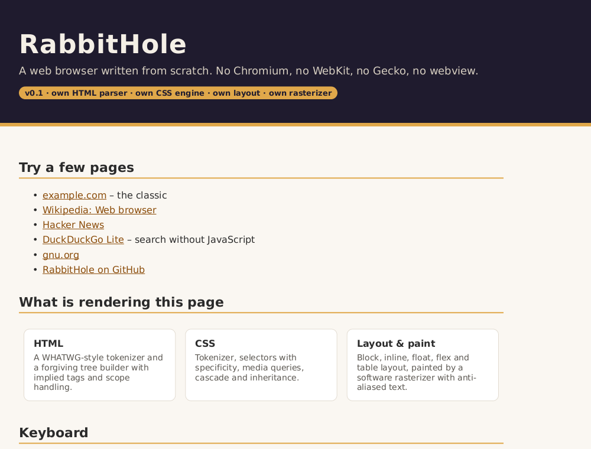
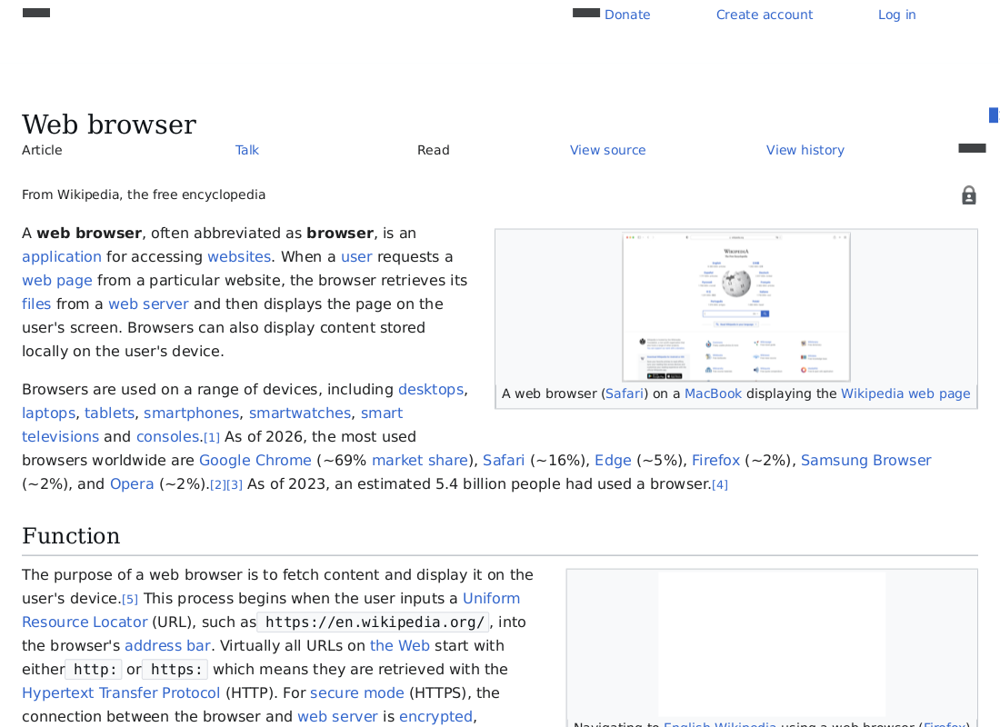

# RabbitHole Browser

**A web browser written from scratch in Rust.** No Chromium, no WebKit, no Gecko,
no system webview. RabbitHole ships its own HTML parser, CSS parser and cascade,
layout engine, font rasterization and a software rasterizer, and paints the
result straight into a native window on Linux, macOS and Windows.

It can be used three ways:

- as a **desktop browser** (a native window, drawn entirely by our own code),
- as a **command line tool** (headless screenshots, text extraction, link listing, tree dumps),
- as an **MCP server** so LLM agents such as Claude can read and screenshot the web through it.





_Both images were produced by `rabbithole screenshot`: every pixel comes from RabbitHole's own rasterizer._

## Features

**Parsing & styling**

- HTML5-style tokenizer and forgiving tree builder (implied tags, void elements,
  raw text elements, character references, inline SVG/MathML nesting) plus DOM
  mutation and serialization (`innerHTML`-ready).
- CSS: full selector support (combinators, attribute operators, `:nth-*`,
  `:not`/`:is`/`:where`/`:has`, `:hover`/`:focus`/`:checked`, `::before`/`::after`/
  `::marker`), specificity, `!important`, `@media`, `@import`, `@supports`,
  `@font-face`, `@keyframes`, custom properties (`var()`), `calc()`/`min()`/`max()`/
  `clamp()`, and the whole property set used by real sites: flexbox, grid,
  multi-layer backgrounds with gradients, border radii, box/text shadows,
  transforms, outlines, `object-fit`, `aspect-ratio`, generated content with
  counters and quotes, text-overflow, word-break, logical properties, and more.

**Layout & painting**

- Block, inline, float, table (auto column algorithm), **flexbox** (multi-line,
  grow/shrink, alignment, gaps) and **CSS grid** (explicit/implicit tracks,
  `repeat()`, `minmax()`, areas, auto-placement) layout.
- Positioning: relative, absolute, fixed, sticky; scroll containers with inner
  scrolling; stacking contexts and z-index painting order.
- Own software rasterizer: anti-aliased paths, strokes, gradients, blurred
  shadows, per-corner radii, transforms, opacity layers, image scaling and
  tiling; glyphs rasterized from TrueType/OpenType, WOFF and WOFF2 web fonts and
  the fonts installed on the system (DejaVu is bundled as the fallback).
- Own SVG renderer (inline `<svg>` and `.svg` images): paths, shapes, text,
  gradients, transforms, `use`/`symbol`, clip paths, CSS-styled icons.

**JavaScript**

- Own JavaScript engine (`crates/js`): ES2022 parser, bytecode compiler, VM
  with generators and async/await, mark-and-sweep GC, the standard library
  (Object/Array/String/Number/Math/JSON/Promise/RegExp/Symbol/Reflect/Proxy/
  Error, Date, Map/Set, typed arrays, Intl basics) and an ECMAScript regular
  expression engine.
- Web platform bindings (`crates/script`, in progress): `window`, `document`,
  DOM traversal and mutation, events, timers, `fetch`/`XMLHttpRequest`,
  storage, CSSOM, observers.

**Networking & the browser**

- Own URL parser/resolver, HTTP/HTTPS with pure-Rust TLS, keep-alive connection
  pool, gzip, manual redirects, cookies (RFC 6265, persisted), form submission
  (GET/POST, urlencoded and multipart), streaming downloads, `file:`, `data:`
  and `about:` URLs, charset detection.
- Browser UI drawn entirely by the engine: tabs, address bar with history
  suggestions, bookmarks, history, downloads, find in page, text selection and
  clipboard, zoom and HiDPI, form controls (text fields, checkboxes, radios,
  selects, buttons), context menu, asynchronous loading with progress.

## Limitations (for now)

- JavaScript: ES modules are supported; some rarer syntax (e.g. object rest
  with computed keys) is not yet, so very large app bundles may partially fail;
  no `<canvas>` 2D context, no shadow DOM isolation.
- No complex text shaping (Latin/Cyrillic/Greek etc. render fine; Arabic and
  Indic scripts do not), color emoji fonts render blank.
- CSS animations/transitions are parsed but not run; `backdrop-filter`,
  3D transforms and `mix-blend-mode` are ignored.
- File uploads in forms are not supported yet.

## Building

Requires a recent stable Rust toolchain.

```sh
cargo build --release
./target/release/rabbithole
```

The GUI uses `winit` and `softbuffer`; on Linux you need an X11 or Wayland
session (the usual `libxkbcommon`/`wayland` client libraries are loaded at
runtime). The headless subcommands and the MCP server do not need a display.

Machines without a system C toolchain (no `gcc`/`cc`) can build with Zig as
the linker: see `scripts/dev-env.sh`.

## Usage

### Desktop browser

```sh
rabbithole                       # opens about:home
rabbithole https://example.com
```

Keyboard: `Ctrl+L`/`F6` focus the URL bar, `Enter` navigate, `Esc` cancel,
`F5`/`Ctrl+R` reload, `Alt+←`/`Alt+→` or `Backspace` history, arrows /
`PageUp`/`PageDown`/`Space`/`Home`/`End` scroll, `Ctrl+T`/`Ctrl+W` tabs,
`Ctrl+F` find, `Ctrl+D` bookmark, `Ctrl+H` history, `Ctrl+J` downloads,
`Ctrl+Shift+J` JavaScript console, `Ctrl+±` zoom, `F11` fullscreen, `Ctrl+Q`
quit. Typing something that is not a URL searches DuckDuckGo.

### Command line

```sh
# Headless screenshot (PNG)
rabbithole screenshot https://example.com -o example.png
rabbithole screenshot https://example.com --width 1024 --height 768 --full
rabbithole screenshot https://example.com --scroll 600 --no-images

# Readable text of a page (Markdown-ish)
rabbithole text https://example.com

# All links as "text<TAB>href"
rabbithole links https://example.com

# Parsed DOM and/or layout tree
rabbithole dump https://example.com --dom
rabbithole dump https://example.com --layout

# Evaluate JavaScript in the page after its own scripts ran
rabbithole js https://news.ycombinator.com/ 'document.querySelectorAll(".titleline").length'

# Every page command accepts --no-js, --wait <ms> and --verbose
rabbithole text https://example.com --no-js

rabbithole --help
```

### MCP server (Model Context Protocol)

`rabbithole mcp` speaks JSON-RPC 2.0 over stdio and exposes these tools:

| Tool         | Arguments                                            | Returns                                   |
|--------------|------------------------------------------------------|-------------------------------------------|
| `browse`     | `url`, `max_chars?`, `images?`                       | title, final URL and the page text        |
| `links`      | `url`, `filter?`                                     | `text — href` lines                       |
| `screenshot` | `url`, `width?`, `height?`, `full_page?`, `scroll_y?`| a PNG image plus a caption                |
| `fetch_html` | `url`, `max_chars?`                                  | raw decoded HTML source                   |
| `dom`        | `url`, `max_chars?`                                  | the parsed DOM tree                       |
| `cookies`    | `url`                                                | stored cookies that apply to the URL      |
| `evaluate`   | `expression`, `url?`, `reload?`                      | the result of the JavaScript expression   |
| `click`      | `selector`, `url?`                                   | page text after the click (links/forms followed) |
| `fill`       | `fields` (selector → value), `submit?`, `url?`       | page text after filling / submitting      |

Page-loading tools also take `javascript?` (default true) and `wait_ms?`
(default 1500). `evaluate`, `click` and `fill` keep a *current page*: omit
`url` to keep interacting with the page left by the previous call.

Claude Code:

```sh
claude mcp add rabbithole -- /path/to/rabbithole mcp
```

Claude Desktop (or any MCP client), in its `mcpServers` configuration:

```json
{
  "mcpServers": {
    "rabbithole": {
      "command": "/path/to/rabbithole",
      "args": ["mcp"]
    }
  }
}
```

## Architecture

A Cargo workspace; each stage of the pipeline is its own crate:

| Crate            | Role                                                                 |
|------------------|----------------------------------------------------------------------|
| `crates/dom`     | Arena-based DOM (nodes, elements, attributes, traversal).            |
| `crates/html`    | HTML tokenizer, entity decoding and tree builder.                    |
| `crates/css`     | CSS tokenizer, selector parser/matcher, stylesheet and media queries.|
| `crates/style`   | User-agent stylesheet, value parsing, cascade and computed styles.   |
| `crates/gfx`     | Canvas + software rasterizer, fonts and glyph cache, image decoding. |
| `crates/net`     | URL parsing/resolution, fetching (HTTP(S)/file/data/about), charsets.|
| `crates/layout`  | Box tree, block/inline layout, display list, painting.               |
| `crates/engine`  | Glue: load → parse → style → layout → paint, hit testing, text dump. |
| `app`            | The `rabbithole` binary: GUI (winit + softbuffer), CLI and MCP server.|

Pipeline: `net` fetches bytes → `html` builds a `dom::Document` → `css` parses
stylesheets → `style` computes a `ComputedStyle` per element → `layout`
positions boxes and emits a display list → `gfx` rasterizes it → the app blits
the canvas into the window (or a PNG, or an MCP response).

Threads in the desktop browser: the UI thread owns the window, the chrome
(tabs, address bar, menus, find bar, console) and presents frames; every tab's
engine and page live on a content thread of its own (`app/src/gui/content`),
fed with input/navigation messages and answering with rasterized frames,
title, URL, cursor, console lines and navigation requests. Frames are painted
taller than the viewport, so scrolling is instant even while a page runs a
long script; a page busy for more than a few seconds gets a "not responding"
bar (wait / stop) instead of freezing the window. Pages are shown as soon as
the document and CSS are ready; images and scripts arrive afterwards.
`RH_UI_STATS=1` logs UI-thread stalls, Ctrl+Shift+U shows them on screen, and
`rabbithole ui-bench <URL> [--legacy]` measures them headlessly.

External crates are limited to platform plumbing, not browser functionality:
`winit` (windows/input), `softbuffer` (presenting pixels), `fontdue` (TrueType
glyph rasterization), `image` (PNG/JPEG/GIF/WebP decoding), `ureq` + `rustls`
(HTTP and TLS), `serde_json` (MCP messages).

## Roadmap

- Floats, proper tables and a real flexbox implementation.
- Absolute/fixed positioning and `z-index` stacking.
- Background images, gradients, `border-radius` per corner, box shadows.
- Text selection, find in page, zoom, tabs, bookmarks and history persistence.
- Cookies and form submission (GET/POST).
- A JavaScript engine (the long way down the rabbit hole).

## License

MIT — see [LICENSE](LICENSE). Bundled DejaVu fonts are distributed under their
own license, see `assets/fonts/LICENSE-DejaVu.txt`.
